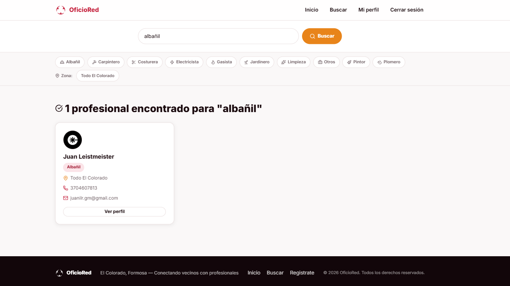
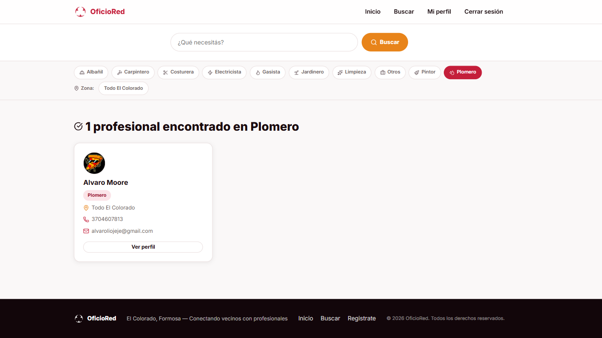
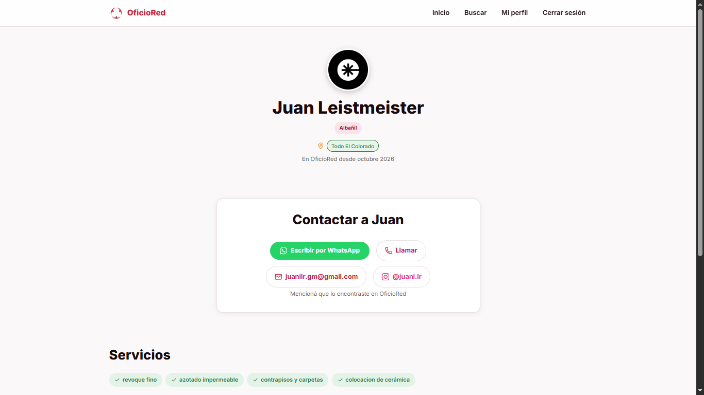
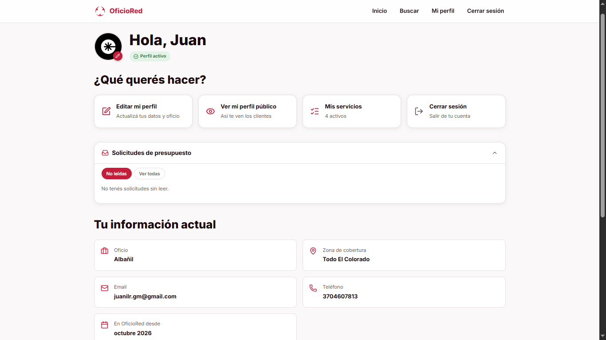
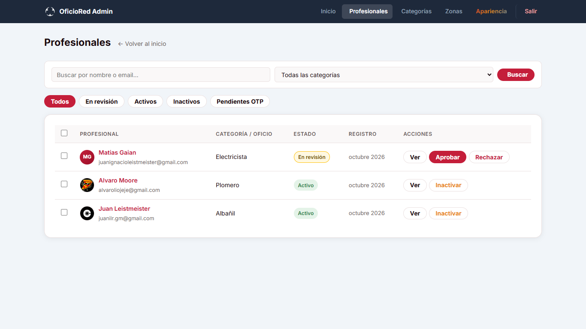
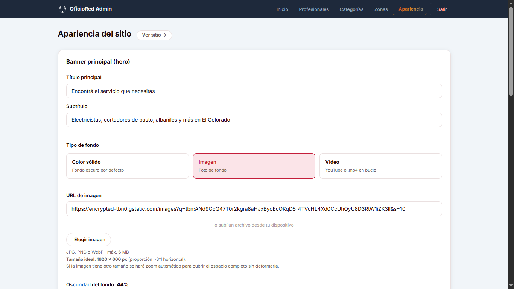
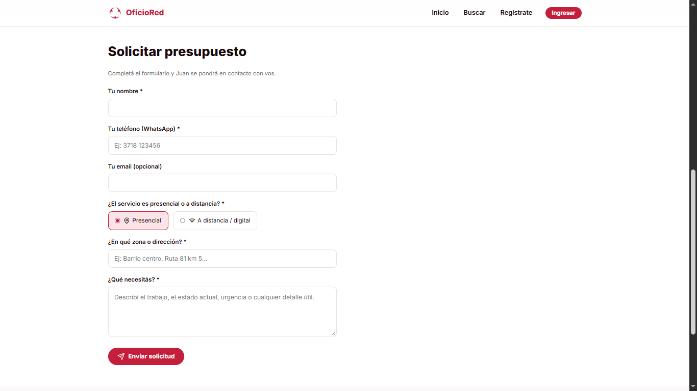

# PRÁCTICAS PROFESIONALIZANTES II – TALLER | ETAPA 3  
## TP12 – Documentación técnica y preparación de la demostración final  
### Reentrega — Ciclo 2026

> **Versión final de la carpeta técnica.** Incorpora las observaciones de la devolución docente (TP12 *aprobado con observaciones obligatorias*). Actualizado el 08/10/2026.

---

## 1. Datos generales

| Campo | Valor |
|---|---|
| **Nombre del proyecto** | OficioRed |
| **Grupo N.º** | 12 |
| **Integrantes** | Juan Leistmeister · Lisandro · Mirian |
| **Usuario principal** | Vecino/cliente que busca un profesional de oficios en El Colorado (Formosa) |
| **Feature / línea funcional trabajada** | Directorio de profesionales de oficios con búsqueda, perfiles públicos, gestión de profesionales y panel de administración |
| **Versión / rama / commit de referencia** | Rama: `main` · Commit: `1d3be3cc4f3dc7af54e2f7d9521138d3df0ada1d` |
| **Fecha** | 02/10/2026 |

---

## 2. Resumen ejecutivo del proyecto

**Problema o necesidad**  
En El Colorado (Formosa) no existe un canal digital local que permita a los vecinos encontrar rápidamente electricistas, plomeros, albañiles u otros trabajadores independientes de la zona. El contacto se da por recomendaciones informales o grupos de WhatsApp, sin garantía de disponibilidad ni datos verificados.

**Solución propuesta**  
OficioRed es un directorio web de profesionales de oficios que permite a los vecinos buscar y contactar trabajadores por categoría y zona de cobertura, y a los propios trabajadores publicar y gestionar su perfil de forma gratuita. Un panel de administración permite moderar los perfiles antes de que sean públicos.

**Usuario principal y finalidad**  
Vecinos de El Colorado que necesitan contratar un servicio puntual (cliente), profesionales independientes que quieren conseguir más trabajo (profesional), y administradores del sitio que gestionan el directorio (admin).

**Alcance actual del PMF/prototipo**  
El prototipo cubre el flujo completo de búsqueda y contacto, el flujo de registro y gestión del profesional, y el flujo de moderación administrativa. Quedan fuera: deploy en producción, sistema de reseñas, formulario de solicitud de presupuesto y paginación de resultados.

---

## 3. Versión estable seleccionada

| Campo | Valor |
|---|---|
| **Mecanismo de respaldo** | Git (repositorio local) |
| **Rama** | `main` |
| **Commit** | `1d3be3cc4f3dc7af54e2f7d9521138d3df0ada1d` |
| **Fecha de la versión** | 05/09/2026 |
| **Motivo por el que se considera estable** | Es el último commit integrado tras la validación funcional de TP11 (pruebas PF-1 a PF-4 aprobadas). Los tres flujos principales fueron verificados en entorno local sin errores críticos. |

---

## 4. Funcionalidades y estado actual

### 4.1. MVP original vs. prototipo actual vs. brecha

| Funcionalidad | MVP original (TP3) | Estado actual | Brecha |
|---|---|---|---|
| Búsqueda de profesionales por oficio | ✅ Requerida | ✅ Implementada | — |
| Filtro por categoría | ✅ Requerida | ✅ Implementada | — |
| Perfil público del profesional | ✅ Requerida | ✅ Implementado | — |
| Registro de profesional | ✅ Requerida | ✅ Implementado | — |
| Login / autenticación | ✅ Requerida | ✅ Implementado | — |
| Dashboard del profesional | ✅ Requerida | ✅ Implementado | — |
| Edición de perfil y foto | ✅ Requerida | ✅ Implementado | — |
| Gestión de servicios ofrecidos | ✅ Requerida | ✅ Implementado | — |
| Panel de administración (aprobar/rechazar) | ✅ Requerida | ✅ Implementado | — |
| Gestión de categorías en admin | ✅ Requerida | ✅ Implementado | — |
| Contacto directo (teléfono/email visible) | ✅ Requerida | ✅ Implementado | — |
| Formulario de solicitud de presupuesto | ✅ Requerida | ✅ Implementado | — |
| Recuperación de contraseña (email) | ❌ Fase 2 | ✅ Implementado | Fuera del MVP (incorporación post-MVP) |
| Sistema de reseñas | ❌ Fase 2 | ❌ No implementado | Fuera del MVP |
| Deploy en producción | ❌ Fase 2 | ❌ No implementado | Fuera del MVP |
| Paginación de resultados | ❌ Fase 2 | ✅ Implementado | Fuera del MVP (incorporación post-MVP) |

> **Nota (corrección de coherencia histórica):** la recuperación de contraseña **no formaba parte del MVP original del TP3**; fue una incorporación posterior (Fase 2). Por eso en esta tabla figura como `Fase 2` y no como requerida, en coherencia con la lista de "Incorporaciones post-MVP" que sigue.

**Incorporaciones post-MVP (Fase 2 documentada):**  
Las siguientes funcionalidades se desarrollaron por fuera del MVP original y deben ser documentadas formalmente en una revisión futura del Backlog:

- Verificación de identidad (DNI) con insignia visual en perfil y tarjeta
- Panel de apariencia del sitio (hero, CTA, colores, texto personalizable)
- Gestión de zonas de cobertura desde admin
- Recuperación de contraseña con token de un solo uso y expiración
- Barra de categorías sticky en páginas de búsqueda

### 4.2. Tabla de funcionalidades detallada

| Funcionalidad / módulo | Usuario | Estado | Evidencia | Observaciones |
|---|---|---|---|---|
| Búsqueda por texto (oficio/nombre) | Cliente | ✅ Implementada | Capturas E1, E2 | buscar.php con PDO |
| Filtro por categoría | Cliente | ✅ Implementada | Capturas E1, E2 | Usa `id_categoria` (no texto) |
| Perfil público | Cliente | ✅ Implementada | Captura E3 | perfil.php |
| Registro de profesional | Profesional | ✅ Implementado | — | Con validaciones y estado `en_revision` |
| Login / sesión | Profesional / Admin | ✅ Implementado | — | Con regeneración de session ID |
| Dashboard profesional | Profesional | ✅ Implementado | Captura E4 | dashboard.php |
| Edición de perfil y foto | Profesional | ✅ Implementado | — | Validación de tipo y tamaño de imagen |
| Gestión de servicios | Profesional | ✅ Implementado | — | mis-servicios.php, CRUD completo |
| Recuperación de contraseña | Profesional | ✅ Implementado | — | Token con expiración, email via PHPMailer (incorporación Fase 2) |
| Panel admin – profesionales | Admin | ✅ Implementado | Captura E5 | Aprobar / Rechazar / Inactivar / Eliminar |
| Panel admin – categorías | Admin | ✅ Implementado | — | CRUD con icono picker (Lucide) |
| Panel admin – zonas | Admin | ✅ Implementado | — | Activar / Desactivar |
| Panel admin – verificaciones DNI | Admin | ✅ Implementado | — | Cola de pendientes |
| Panel admin – apariencia | Admin | ✅ Implementado | Captura E6 | Configura hero/CTA/texto del sitio |
| Formulario de solicitud de presupuesto | Cliente | ✅ Implementado | Captura E7 | solicitar-presupuesto.php — validación, email al profesional, WhatsApp |

---

## 5. Arquitectura y flujo principal

```
Cliente (navegador)
    │
    ▼
index.php / buscar.php
    │  GET con parámetros q, cat, zona
    ▼
buscar.php → PDO → MySQL/MariaDB (tabla: profesionales JOIN categorias JOIN zonas)
    │  WHERE estado = 'activo'
    ▼
includes/card-profesional.php  (parcial reutilizable)
    │
    ▼
Respuesta HTML completa al navegador
```

**Flujo secundario — registro y moderación:**
```
Profesional → registro.php (POST) → INSERT en profesionales (estado='en_revision')
    │
    ▼
Admin → admin/profesionales.php → Aprobar → UPDATE estado='activo' + email de bienvenida
    │
    ▼
Perfil visible en búsquedas públicas
```

| Campo | Valor |
|---|---|
| **Inicio del flujo** | Usuario accede a index.php o escribe en el buscador |
| **Componentes involucrados** | index.php, buscar.php, includes/db.php, includes/funciones.php, includes/card-profesional.php, PDO, MariaDB |
| **Datos que circulan** | Parámetros GET (`q`, `cat`, `zona`), resultados de consulta SQL, HTML renderizado server-side |
| **Dependencias principales** | PHP 8, MariaDB 10.4, Apache (XAMPP), PDO |
| **Fin del flujo / resultado observable** | Grid de tarjetas de profesionales con nombre, oficio, zona, contacto y botón "Ver perfil" |

---

## 6. Componentes técnicos principales

| Componente | Tipo/capa | Responsabilidad | Archivo/ruta |
|---|---|---|---|
| `index.php` | Frontend / controlador | Página de inicio: hero, categorías, destacados | `/index.php` |
| `buscar.php` | Frontend / controlador | Búsqueda y filtro de profesionales | `/buscar.php` |
| `perfil.php` | Frontend / controlador | Perfil público de un profesional | `/perfil.php` |
| `registro.php` | Frontend / controlador | Registro de nuevo profesional | `/registro.php` |
| `login.php` | Frontend / controlador | Autenticación de usuario | `/login.php` |
| `dashboard.php` | Frontend / controlador | Panel del profesional autenticado | `/dashboard.php` |
| `editar-perfil.php` | Frontend / controlador | Edición de datos propios | `/editar-perfil.php` |
| `mis-servicios.php` | Frontend / controlador | Gestión de servicios ofrecidos | `/mis-servicios.php` |
| `recuperacion.php` | Frontend / controlador | Solicitud de recuperación de contraseña | `/recuperacion.php` |
| `nueva-password.php` | Frontend / controlador | Reset de contraseña con token | `/nueva-password.php` |
| `admin/` | Frontend / controlador | Panel de administración completo | `/admin/*.php` |
| `includes/db.php` | Infraestructura | Conexión PDO a MariaDB | `/includes/db.php` |
| `includes/funciones.php` | Lógica compartida | `sanitizar()`, `csrf_token()`, `obtener_categorias()`, etc. | `/includes/funciones.php` |
| `includes/mailer.php` | Infraestructura | Envío de emails via PHPMailer/SMTP | `/includes/mailer.php` |
| `includes/card-profesional.php` | Vista (parcial) | Tarjeta reutilizable de profesional | `/includes/card-profesional.php` |
| `includes/header.php` | Vista (parcial) | Cabecera, navegación y nav de categorías | `/includes/header.php` |
| `css/estilos.css` | Presentación | Estilos del sitio público | `/css/estilos.css` |
| `css/admin.css` | Presentación | Estilos del panel de administración | `/css/admin.css` |
| `sql/` | Base de datos | Scripts SQL de migración por versión | `/sql/v*.sql` |

---

## 7. Modelo de datos / persistencia

| Tabla / entidad | Propósito | Datos relevantes | Relaciones / restricciones |
|---|---|---|---|
| `profesionales` | Perfil de cada profesional | id, nombre, apellido, email, telefono, oficio (legacy), foto_perfil, estado, dni_verificado, fecha_registro | FK: `id_categoria` → `categorias` |
| `categorias` | Categorías de oficio | id, nombre, descripcion, icono_lucide, orden | — |
| `profesionales_zonas` | Zonas de cobertura por profesional | id_profesional, id_zona | FK a ambas tablas |
| `zonas` | Barrios/sectores de El Colorado | id, nombre, orden, estado | — |
| `servicios` | Servicios específicos ofrecidos | id, id_profesional, titulo, descripcion, precio_desde | FK → `profesionales` |
| `usuarios` | Credenciales de acceso (admin y profesionales) | id, email, contrasena (hash bcrypt), id_profesional, rol | rol ∈ {admin, profesional} |
| `tokens_recuperacion` | Tokens temporales para reset de contraseña | token (hash), id_usuario, expiracion, usado | FK → `usuarios` · expiración 1 h |
| `configuracion_sitio` | Configuración visual del sitio | clave, valor | clave única; valores: hero_titulo, hero_tipo, cta_*, etc. |

**Consulta principal del buscador (buscar.php):**
```sql
SELECT p.id_profesional, p.nombre, p.apellido, p.oficio,
       p.zona_cobertura, p.telefono, p.email, p.foto_perfil,
       p.dni_verificado, c.nombre AS categoria_nombre
FROM profesionales p
LEFT JOIN categorias c ON p.id_categoria = c.id_categoria
WHERE p.estado = 'activo'
  AND (p.nombre LIKE ? OR p.apellido LIKE ? OR p.oficio LIKE ?)
ORDER BY p.fecha_registro DESC
```

La condición `AND p.estado = 'activo'` es obligatoria en todas las consultas públicas.

---

## 8. Repositorio y README

| Campo | Valor |
|---|---|
| **URL o ubicación del repositorio** | Repositorio local Git en `C:\xampp\htdocs\oficiored` · Rama: `main` · Commit: `1d3be3c` |
| **README ubicado en** | Raíz del proyecto (`/README.md`) — **creado** |
| **Describe qué hace el proyecto** | Sí — el README describe OficioRed, stack, estructura, instalación, configuración, ejecución, versión, estado actual y pendientes |
| **Incluye instalación/ejecución** | Sí — en el `README.md` y en la Sección 9 de este documento |
| **Incluye tecnologías y estructura** | Sí — en el `README.md` y en la Sección 6 de este documento |
| **Incluye estado, limitaciones y equipo** | Sí — en el `README.md` y en las Secciones 4 y 12 de este documento |

> **Resuelto:** se creó `README.md` en la raíz del proyecto (observación obligatoria 1 de la devolución), usando como base la Sección 9 (instalación) y el resumen ejecutivo (Sección 2) de este documento.

---

## 9. Guía de instalación y ejecución

| Paso | Acción | Resultado esperado |
|---|---|---|
| 1 | Instalar XAMPP (PHP 8.x + Apache + MariaDB 10.4) | Servicios disponibles en `localhost` |
| 2 | Copiar la carpeta del proyecto en `C:\xampp\htdocs\oficiored\` | Archivos accesibles desde el servidor |
| 3 | Iniciar Apache y MySQL desde el panel de control de XAMPP | Servicios activos (indicador verde) |
| 4 | Abrir phpMyAdmin (`http://localhost/phpmyadmin`) y crear la base de datos `oficiored` | Base de datos vacía creada |
| 5 | Importar los archivos SQL en orden: `sql/oficiored_v1.sql`, `sql/v2_fase1_*.sql`, `sql/v2_fase2_*.sql`, `sql/v2_fase3_zonas.sql`, `sql/v3_configuracion_sitio.sql` (y opcionalmente `sql/datos_prueba.sql`) | Tablas y datos iniciales cargados |
| 6 | Copiar `includes/config.example.php` como `includes/config.local.php` y configurar host, usuario, contraseña y nombre de BD (más SMTP si se usa recuperación de contraseña) | Conexión PDO funcional |
| 7 | Acceder a `http://localhost/oficiored/` | Página de inicio visible con categorías y profesionales |
| 8 | Acceder al panel admin en `http://localhost/oficiored/admin/` con las credenciales del usuario administrador creado en BD | Panel de administración disponible |

> ⚠️ No escribir contraseñas reales en ningún archivo versionado. Usar `config.local.php` (excluido en `.gitignore`) para las credenciales de base de datos.

---

## 10. Trazabilidad del recorrido TP3–TP11

| TP | Producto/decisión principal | Qué se conserva hoy | Referencia/evidencia |
|---|---|---|---|
| TP3 | Definición del proyecto: directorio de profesionales de oficios en El Colorado. Backlog inicial con HU1–HU7 y criterios de aceptación. | Las HU1 (búsqueda), HU2 (registro), HU3 (perfil público), HU5 (login), HU6 (dashboard) y HU7 (panel admin) están todas implementadas. | Archivo `GRUPO_13_BACKLOG_HISTORIAS_USUARIO_PP2_REENTREGA.docx` |
| TP4 | Feature spec del módulo de búsqueda: inputs (q, zona), lógica de filtrado, visualización en cards. | `buscar.php` implementa exactamente ese spec; `card-profesional.php` es el componente reutilizable que resultó de esa decisión. | Código en `/buscar.php` y `/includes/card-profesional.php` |
| TP5 | Descomposición técnica: arquitectura PHP monolítica por páginas, patrón MVC-lite con `includes/` para lógica compartida. Sin routing centralizado. | Estructura actual del proyecto: cada página es un archivo PHP con `require_once 'includes/...'`. | Árbol de archivos en Sección 6 |
| TP6 | Prompt técnico e implementación con PDO: decisión de migrar de MySQLi a PDO para seguridad (prepared statements) y portabilidad. | Toda la capa de datos usa PDO con `prepare()` / `execute()` con parámetros nombrados. | `/includes/db.php`, todas las consultas en el proyecto |
| TP7 | Implementación asistida del módulo de búsqueda con filtros GET y renderizado server-side de resultados. | `buscar.php` con `$_GET['q']`, `$_GET['cat']`, `$_GET['zona']`; resultados renderizados con `include 'card-profesional.php'`. | `/buscar.php` |
| TP8 | Codificación de tarea técnica prioritaria: autenticación de profesionales con bcrypt, CSRF y regeneración de session ID al login. | `login.php` usa `password_verify()` + `csrf_token()` + `session_regenerate_id(true)`. | `/login.php`, `/includes/funciones.php` |
| TP9 | Ajuste, corrección y validación: seguridad cross-cutting — función `sanitizar()` centralizada, validación de nombres de foto (`foto_nombre_valido()`), patrón PRG en todos los formularios. | `sanitizar()` y `foto_nombre_valido()` en `funciones.php` usadas en todo el proyecto. PRG aplicado en registro, edición y todos los POST del admin. | `/includes/funciones.php` |
| TP10 | Integración funcional: panel de administración con lista de profesionales, filtros de estado, aprobación/rechazo, CRUD de categorías. | `admin/profesionales.php`, `admin/categorias.php`, `admin/profesional-detalle.php` funcionando en producción local. | `/admin/*.php` |
| TP11 | Validación del prototipo e incidencias: pruebas PF-1 a PF-4 (búsqueda, registro, login, panel admin) aprobadas; correcciones de sesión y de visualización de estado. | El flujo completo de los 3 actores (cliente, profesional, admin) fue validado sin errores críticos. Las incidencias detectadas fueron corregidas. | Sección 11 de este documento |

---

## 11. Pruebas funcionales y evidencias

| Caso | Tipo | Esperado | Obtenido | Estado | Evidencia |
|---|---|---|---|---|---|
| PF-1: Búsqueda por oficio | Funcional | Resultados filtrados con estado='activo' | Resultados correctos con el filtro activo | ✅ OK | E1 |
| PF-2: Filtro por categoría desde nav | Funcional | Cards de la categoría seleccionada | Chips activos y resultados filtrados correctamente | ✅ OK | E2 |
| PF-3: Registro de profesional | Funcional | Estado inicial `en_revision`, redirige a en-revision.php | Registro exitoso, estado correcto | ✅ OK | — |
| PF-4: Login y acceso a dashboard | Funcional | Sesión iniciada, redirige a dashboard.php | Login correcto con regeneración de session ID | ✅ OK | E4 |
| PF-5: Perfil público | Funcional | Datos del profesional visibles; foto o avatar | Perfil renderizado con todos los datos | ✅ OK | E3 |
| PF-6: Aprobación de perfil (admin) | Funcional | Estado cambia a `activo`, email enviado | Estado actualizado, email de bienvenida enviado | ✅ OK | E5 |
| PF-7: Recuperación de contraseña | Funcional | Email con enlace de un solo uso y expiración 1h | Email recibido, enlace funcional | ✅ OK | — |
| PF-8: Edición de perfil y foto | Funcional | Datos actualizados, foto reemplazada | Edición persistida, previsualización funciona | ✅ OK | — |
| PF-9: Acceso a admin sin sesión | Seguridad | Redirección a login.php | Redirige correctamente | ✅ OK | — |
| PF-10: Inyección SQL en buscador | Seguridad | Sin error ni resultado inválido | PDO bloquea la inyección | ✅ OK | — |
| PF-11: Apariencia del sitio desde admin | Funcional | Cambios de hero/CTA persistidos y visibles en index.php | Cambios visibles inmediatamente | ✅ OK | E6 |
| PF-12: Profesional inactivo no aparece | Seguridad | No figura en búsquedas | No figura | ✅ OK | — |

---

## 12. Incidencias y pendientes técnicos

| ID | Incidencia / pendiente | Severidad | Prioridad | Estado | Próxima acción |
|---|---|---|---|---|---|
| INC-01 | Formulario de solicitud de presupuesto no implementado | Media | Alta | **Resuelto** | Implementado: solicitar-presupuesto.php, tabla BD, notificación por email, panel en dashboard |
| INC-02 | README.md no existe en el repositorio | Baja | Media | **Resuelto** | README.md creado en la raíz con base en Sección 9 y Sección 2 |
| INC-03 | Paginación de resultados en buscar.php | Baja | Baja | Pendiente — Fase 2 | Implementar si el tiempo lo permite |
| INC-04 | Sistema de reseñas | Baja | Baja | Pendiente — Fase 2 | Requiere nueva HU documentada y aprobación |
| INC-05 | Deploy en producción | Baja | Baja | Pendiente — Fase 2 | Fuera del alcance del prototipo actual |
| INC-06 | Columna ACCIONES en tabla admin requiere scroll en viewport < 1024px | Muy baja | Baja | Mitigado (overflow-x:auto en wrapper) | No crítico para la demo en monitor externo |
| INC-07 | Evidencia E5 no muestra el flujo de aprobación de un profesional `en_revision` | Baja | Media | **Resuelto** | E5 reemplazada por captura del panel admin con profesional "En revisión" y botones Aprobar/Rechazar visibles |

---

## 13. Uso de IA durante el proyecto

| Actividad | Problema planteado | Aporte de IA | Decisión del equipo | Verificación |
|---|---|---|---|---|
| TP5 — Estructura del proyecto | ¿Cómo organizar un proyecto PHP sin framework? | Propuso estructura con `includes/`, páginas por funcionalidad y patrón MVC-lite | Se adoptó la estructura; se eliminaron subcarpetas innecesarias | Revisión manual del árbol de archivos |
| TP6 — Migración a PDO | Cómo migrar consultas MySQLi a PDO con prepared statements | Generó plantillas de conexión PDO y ejemplos de `prepare()`/`execute()` | Se adoptó PDO en todo el proyecto | Pruebas de búsqueda con caracteres especiales y comillas |
| TP7 — Módulo de búsqueda | Lógica de filtros combinados (texto + categoría + zona) | Generó la consulta SQL base con condicionales | Se revisó la consulta, se corrigió la condición `estado='activo'` | PF-1 y PF-2 |
| TP8 — Autenticación | Cómo implementar login seguro con sesiones en PHP | Propuso bcrypt + CSRF + regeneración de session ID | Se adoptó el patrón completo | PF-4, PF-9 |
| TP9 — Seguridad transversal | Validación de entradas, sanitización, PRG | Generó función `sanitizar()` y patrón PRG consistente | Se aplicó en todos los formularios del proyecto | PF-10, revisión de código |
| TP10 — Panel admin | CRUD de profesionales y categorías con acciones de estado | Generó estructura de tabla + formularios de acción | Se ajustó el diseño visual y se agregaron confirmaciones de JS | PF-6 |
| TP11 — Correcciones de validación | Fallos en redirección post-login y visualización de estado | Propuso soluciones puntuales para cada incidencia | Se aplicaron con revisión; se descartó una propuesta de middleware | Re-test de PF-3 a PF-6 |
| Fase 2 — Recuperación de contraseña | Sistema de tokens con expiración y envío de email | Generó estructura de tabla y lógica de token | Se adoptó con ajuste de tiempo de expiración a 1 hora | PF-7 |
| Fase 2 — Panel de apariencia | Configuración dinámica de hero/CTA desde admin | Generó estructura clave-valor en `configuracion_sitio` | Se adoptó; se agregaron sliders de posición de imagen | PF-11 |

---

## 14. Decisiones técnicas relevantes

| Decisión | Alternativa considerada | Justificación | Impacto actual |
|---|---|---|---|
| PHP monolítico por páginas (sin framework ni routing centralizado) | Laravel / Symfony | Reducir la curva de aprendizaje y mantener la pila al alcance del equipo | Simplicidad de deployment; cada página es autónoma y fácil de depurar |
| PDO con prepared statements (migrado desde MySQLi) | MySQLi procedural | Portabilidad y protección nativa contra inyección SQL | Toda la capa de datos es uniforme y segura |
| Parcial `card-profesional.php` reutilizable | Duplicar HTML en cada página | DRY: un solo archivo controla la presentación de la tarjeta en index.php, buscar.php y cualquier página futura | Cambios visuales en un solo lugar |
| `categorias` y `zonas` como tablas en BD (no arrays hardcodeados) | Array de constantes en PHP | Permite al admin agregar/editar categorías y zonas sin tocar código | Extensibilidad real desde el panel de administración |
| Estado `en_revision` intermedio para nuevos registros | Aprobar automáticamente | Garantiza que solo perfiles revisados aparezcan en el directorio | Moderación manual preserva la calidad del directorio |
| `configuracion_sitio` como tabla clave-valor para el hero/CTA | Variables hardcodeadas en PHP | Permite personalización sin redeploy ni edición de código | El admin puede cambiar textos e imágenes del sitio en tiempo real |
| CSRF con `hash_equals` en todos los formularios POST | Sin protección / token en sesión sin comparación segura | `hash_equals` evita ataques de timing; token en sesión es simple y efectivo | Todos los formularios están protegidos |
| `foto_nombre_valido()` antes de servir/eliminar archivos | Confiar en el nombre almacenado | Previene path traversal si un dato en BD fuera manipulado | Seguridad adicional en manejo de archivos de usuario |

---

## 15. Preparación de la demostración final

| Campo | Valor |
|---|---|
| **Duración objetivo** | 5 a 7 minutos |
| **Versión que se demostrará** | Rama `main`, commit `1d3be3c` |
| **Flujo principal elegido** | Cliente busca un electricista → ve el perfil → Profesional tiene su perfil publicado → Admin aprueba un nuevo perfil |
| **Datos de prueba preparados** | Al menos 4 profesionales activos con distintas categorías y zonas; 1 profesional en estado `en_revision` para demo de aprobación |
| **Caso alternativo / validación** | Mostrar que un profesional inactivo no aparece en búsquedas |
| **Integrante que opera** | Lisandro (maneja el teclado/mouse durante toda la demo) |
| **Integrante(s) que explican** | Juan explica el flujo del cliente y la arquitectura · Mirian explica el flujo del profesional y del admin |
| **Plan de contingencia** | Ver sección 15.3 |

### 15.1. Guion cronometrado

| Tiempo | Qué se dice | Qué se muestra | Responsable |
|---|---|---|---|
| 0:00–0:40 | "OficioRed resuelve el problema de encontrar un profesional de oficios en El Colorado. Hoy eso se hace por WhatsApp o recomendación boca a boca. Nuestro sistema es un directorio web local." | Pantalla de inicio (`index.php`) con hero y categorías | Juan |
| 0:40–1:10 | "El stack es PHP 8, MariaDB, PDO, sin framework. Arquitectura monolítica por páginas con includes compartidos." | Árbol de archivos en VS Code o pantalla estática del diagrama | Juan |
| 1:10–2:30 | "Un vecino busca un electricista. Puede buscar por texto o navegar por categoría." | Demostración en vivo: escribir en el buscador → resultados → filtrar por categoría con el chip nav | Lisandro (opera) / Mirian (narra) |
| 2:30–3:30 | "Cada profesional tiene un perfil completo con datos de contacto, servicios y zona de cobertura. El contacto es directo, sin intermediarios ni comisiones." | Abrir perfil de un profesional, mostrar teléfono y email | Lisandro (opera) / Mirian (narra) |
| 3:30–4:30 | "El profesional gestiona su propio perfil desde un panel privado. Acá podés ver el dashboard, la edición de servicios y la foto de perfil." | Login como profesional → dashboard → sección de servicios | Lisandro (opera) / Mirian (narra) |
| 4:30–5:20 | "El admin aprueba los perfiles antes de que sean públicos. Así garantizamos que solo aparecen trabajadores reales y verificados." | Login como admin → ver profesional `en_revision` → aprobar | Lisandro (opera) / Juan (narra) |
| 5:20–6:00 | "Decisión técnica clave: usamos PDO con prepared statements en toda la capa de datos para prevenir inyección SQL. También CSRF en todos los formularios y hash bcrypt para contraseñas." | Mostrar brevemente `funciones.php` con `sanitizar()` y `csrf_token()` | Juan |
| 6:00–6:40 | "El MVP original está completo: incluyendo el formulario de solicitud de presupuesto. Lo que queda fuera del alcance actual son reseñas y deploy, que son Fase 2." | Pantalla con la tabla de estado de funcionalidades (Sección 4.1 de este doc) | Mirian |
| 6:40–7:00 | "El proyecto resuelve el problema planteado en TP3. El flujo completo de los tres actores funciona en entorno local." | Volver a la pantalla de inicio | Juan |

### 15.2. Roles por bloque

| Bloque | Responsable principal | Descripción |
|---|---|---|
| Introducción y problema | Juan | Presenta el contexto y el stack |
| Flujo del cliente (búsqueda y perfil) | Mirian (narra) + Lisandro (opera) | Muestra la experiencia del vecino que busca |
| Flujo del profesional (dashboard) | Mirian (narra) + Lisandro (opera) | Muestra el panel propio del trabajador |
| Flujo del admin (moderación) | Juan (narra) + Lisandro (opera) | Aprobación de perfil en vivo |
| Decisión técnica | Juan | Explica la elección de PDO, CSRF y bcrypt |
| Cierre y pendientes | Mirian | Resume el estado del proyecto y la brecha |

### 15.3. Plan de contingencia

| Falla | Plan B |
|---|---|
| **Falla XAMPP / Apache no inicia** | Tener una copia de la carpeta en un segundo equipo con XAMPP ya configurado y la BD importada |
| **Falla la base de datos (MySQL no inicia)** | Tener un backup `.sql` listo para importar en < 2 minutos desde phpMyAdmin en el equipo de respaldo |
| **Falla el equipo durante la demo** | Contar con un video grabado de 5 minutos que muestre el flujo completo (grabado antes de la presentación con OBS o similar) |
| **Falla la conexión o el proyector** | Tener capturas de pantalla impresas o en PDF de: pantalla de inicio, búsqueda con resultados, perfil de profesional, dashboard y panel admin |

---

## 16. Ensayo y verificación previa

- [x] La versión de demo está respaldada (commit `1d3be3c` en rama `main`).
- [x] Servidor y base de datos inician correctamente en XAMPP.
- [x] El flujo principal fue probado de punta a punta (PF-1 a PF-12).
- [x] Los datos de prueba están preparados (profesionales activos + 1 en revisión).
- [x] No se muestran datos personales o secretos: las capturas usan perfiles de prueba (datos ficticios cargados para la demostración), sin credenciales ni datos reales.
- [x] Los integrantes conocen su rol (ver Sección 15.2).
- [x] Guion completo: duración objetivo 7 minutos (bloques de duración variable; total ≈ 7 min).
- [x] Existe plan de contingencia (ver Sección 15.3).
- [x] Las evidencias coinciden con la versión de demo.
- [x] Los pendientes no se presentan como funcionalidades terminadas.

---

## 17. Evidencias a incorporar

| Evidencia | Qué muestra | Qué criterio/caso respalda |
|---|---|---|
| E1 | Búsqueda por texto ("albañil") con resultado filtrado y cards | PF-1: búsqueda funcional por oficio |
| E2 | Chip de categoría "Plomero" activo y resultado filtrado | PF-2: filtro por categoría desde nav |
| E3 | Perfil público de un profesional: zona, botones WhatsApp/Llamar/Instagram, servicios | PF-5: perfil público completo |
| E4 | Dashboard del profesional autenticado: acciones rápidas, solicitudes, datos de perfil | PF-4: login y dashboard funcional |
| E5 | Panel admin con profesional en estado **"En revisión"** y botones **Aprobar / Rechazar** visibles | PF-6: flujo de moderación — resuelve INC-07 |
| E6 | Panel de apariencia del admin con configuración de hero (imagen, título, subtítulo) activa | PF-11: apariencia configurable desde admin |
| E7 | Formulario de solicitud de presupuesto en el perfil de un profesional (vista cliente sin sesión) | INC-01 resuelto: formulario completo con modalidad, zona y descripción |

> **Estado:** las 7 evidencias (E1–E7) están incorporadas en el **Anexo de Evidencias** al final de este documento. INC-01 e INC-07 resueltos.

---

## 18. Autoevaluación final del grupo

| Criterio | Respuesta |
|---|---|
| La documentación coincide con el sistema real | **Sí.** Todo lo documentado fue verificado en el sistema en entorno local durante el audit de los 3 flujos. |
| Otra persona podría ejecutar el sistema con estas instrucciones | **Sí.** La Sección 9 y el `README.md` detallan pasos reproducibles con XAMPP estándar. |
| La demo muestra un flujo funcional y no solo pantallas | **Sí.** El guion (Sección 15.1) muestra los 3 flujos principales en ejecución real, no mockups. |
| Las incidencias conocidas están declaradas | **Sí.** Sección 12 lista las incidencias/pendientes con estado y próxima acción. |
| El uso de IA está suficientemente documentado | **Sí.** Sección 13 documenta 9 instancias de uso de IA con la decisión tomada y cómo se verificó. |
| Estado final para la demostración | **Listo.** Todas las funcionalidades del MVP original implementadas, incluyendo el formulario de solicitud de presupuesto (INC-01 resuelto). Evidencias E1–E7 incorporadas. INC-07 resuelto con nueva captura E5. |

### Checklist de entrega

- [x] Usamos la versión real y estable del proyecto (commit `1d3be3c`)
- [x] No comenzamos una nueva feature durante TP12
- [x] README.md creado en la raíz
- [x] Documentamos instalación y ejecución (Sección 9 y README.md)
- [x] Representamos arquitectura/flujo (Sección 5)
- [x] Actualizamos modelo de datos (Sección 7)
- [x] Registramos estado de funcionalidades (Sección 4)
- [x] Incluimos pruebas y evidencias (Sección 11 + Sección 17 + Anexo)
- [x] Registramos incidencias y pendientes (Sección 12)
- [x] Documentamos decisiones técnicas y uso de IA (Secciones 13 y 14)
- [x] Registramos rama/commit (Secciones 1 y 3)
- [x] Preparamos guion de demo (Sección 15.1)
- [x] Definimos roles y plan de contingencia (Secciones 15.2 y 15.3)
- [x] Verificado: sin credenciales ni datos sensibles; las capturas usan perfiles de prueba (datos ficticios)
- [x] Las 7 capturas (E1–E7) incorporadas en el Anexo de Evidencias

---

*OficioRed — Grupo 12 — Prácticas Profesionalizantes II — Ciclo 2026*

---

## Anexo — Evidencias de funcionamiento

### E1 — Búsqueda por texto



*Búsqueda del término "albañil" en `buscar.php`. Se muestra 1 profesional encontrado con su tarjeta completa (nombre, categoría, zona, teléfono, email y botón "Ver perfil").*

---

### E2 — Filtro por categoría



*Filtro activo por categoría "Plomero" (chip resaltado en rojo). El sistema devuelve los profesionales de esa categoría únicamente.*

---

### E3 — Perfil público del profesional



*Perfil público de un profesional activo con: avatar, nombre, oficio, zona de cobertura, botón WhatsApp, Llamar, email e Instagram, y listado de servicios.*

---

### E4 — Dashboard del profesional



*Panel privado del profesional logueado: estado del perfil ("Perfil activo"), acciones rápidas (editar, ver perfil público, servicios), sección de solicitudes de presupuesto e información actual.*

---

### E5 — Panel admin — moderación de perfiles



*Panel de administración (`admin/profesionales.php`) con un profesional en estado "En revisión". Se ven claramente los botones **Aprobar** y **Rechazar** disponibles para el administrador. Resuelve INC-07.*

---

### E6 — Panel de apariencia del admin



*Panel de apariencia (`admin/apariencia.php`) con configuración del hero activa: tipo "Imagen", URL de imagen cargada, título y subtítulo editables.*

---

### E7 — Formulario de solicitud de presupuesto



*Formulario de solicitud de presupuesto visible en el perfil público de un profesional (vista de cliente sin sesión iniciada). Incluye campos de nombre, teléfono, email opcional, modalidad presencial/digital, zona y descripción del trabajo. Resuelve INC-01.*

